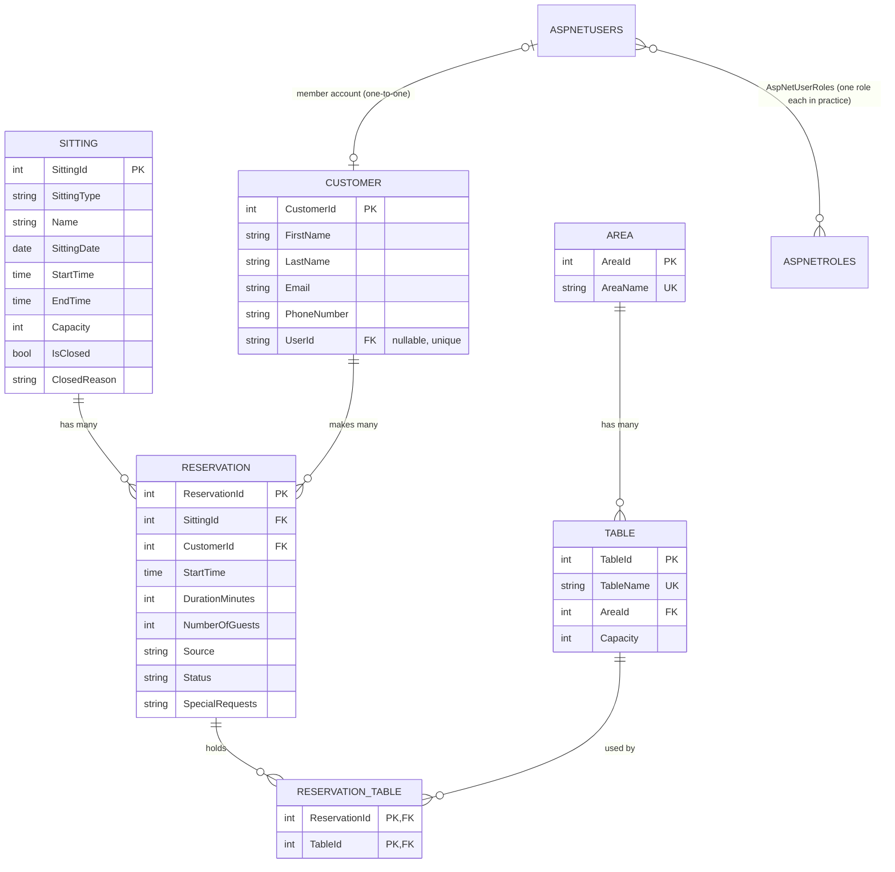
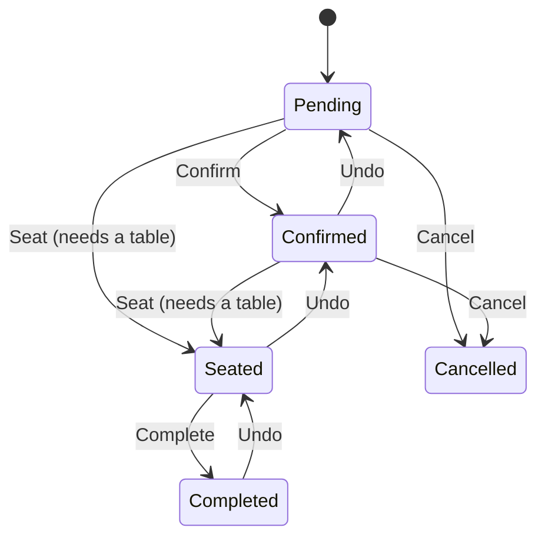
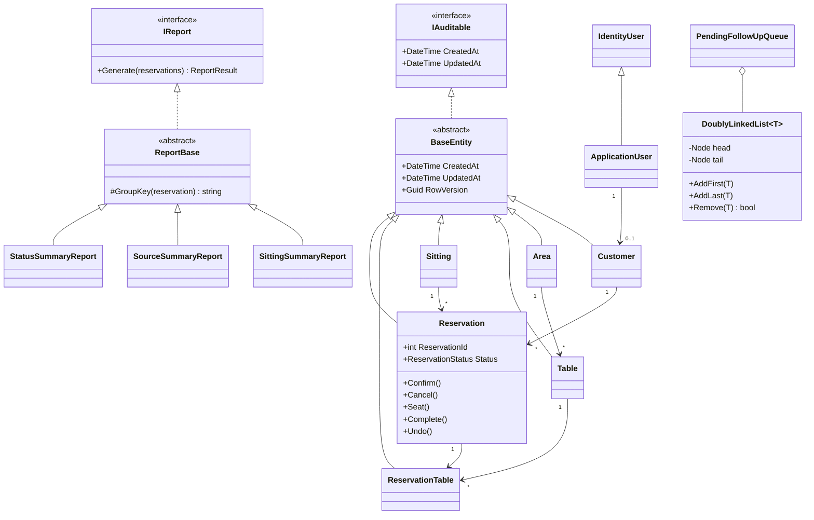

# Entity relationship diagram and class diagram

## ERD (Mermaid)

Paste the code block into https://mermaid.live or open this file in VS Code / GitHub to see the diagram.

Every Bean Scene table also has `CreatedAt`, `UpdatedAt` and `RowVersion` (from `BaseEntity`).

## Relationships

| Relationship | Type | How it is mapped |
|---|---|---|
| Area - Table | One-to-many | `Table.AreaId` FK, `Area.Tables` / `Table.Area` navigation properties |
| Sitting - Reservation | One-to-many | `Reservation.SittingId` FK |
| Customer - Reservation | One-to-many | `Reservation.CustomerId` FK |
| Reservation - Table | **Many-to-many** | `ReservationTable` join entity with composite key (`ReservationId`, `TableId`) |
| ApplicationUser - Customer | **One-to-one** (optional) | `Customer.UserId` FK with a unique index |
| ApplicationUser - ApplicationRole | Many-to-many (Identity) | `AspNetUserRoles`; the app gives each user exactly one role |

## Reservation status workflow

Undo is not allowed for a day that has passed. A cancelled booking cannot be brought back.

## Class diagram (Mermaid)

